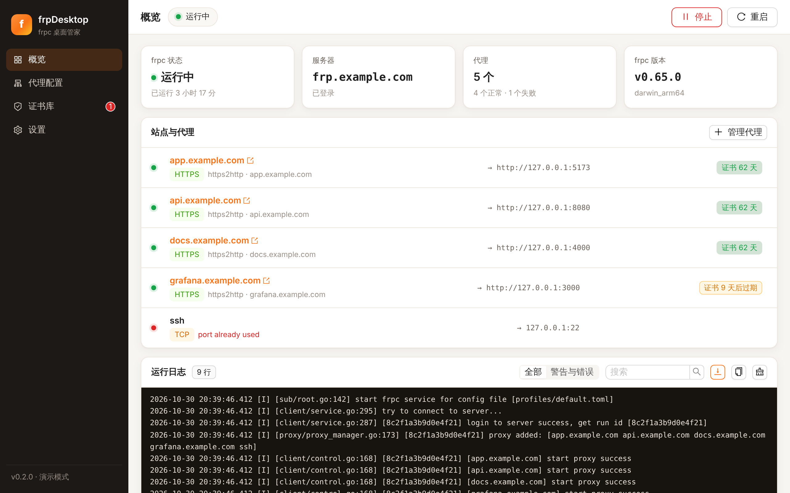
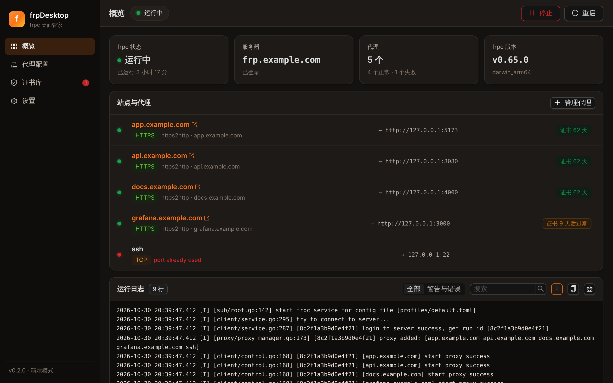
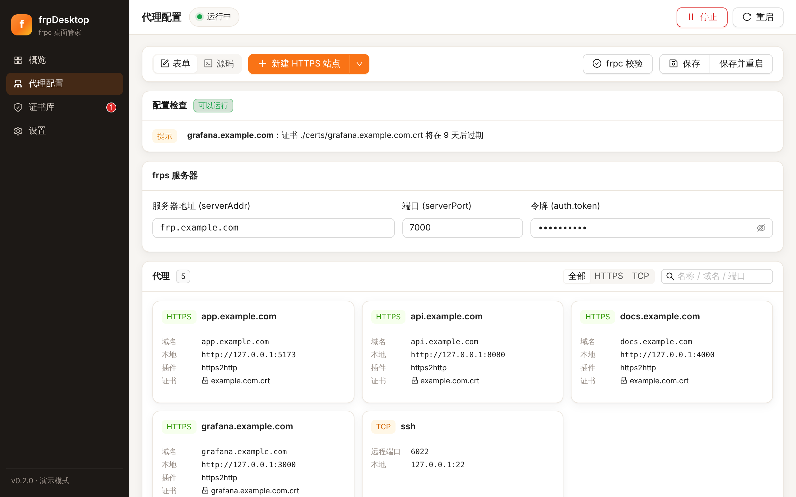
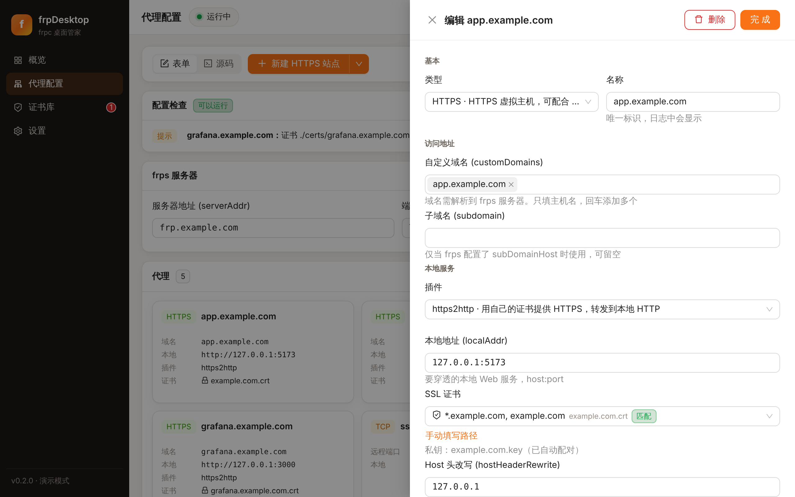
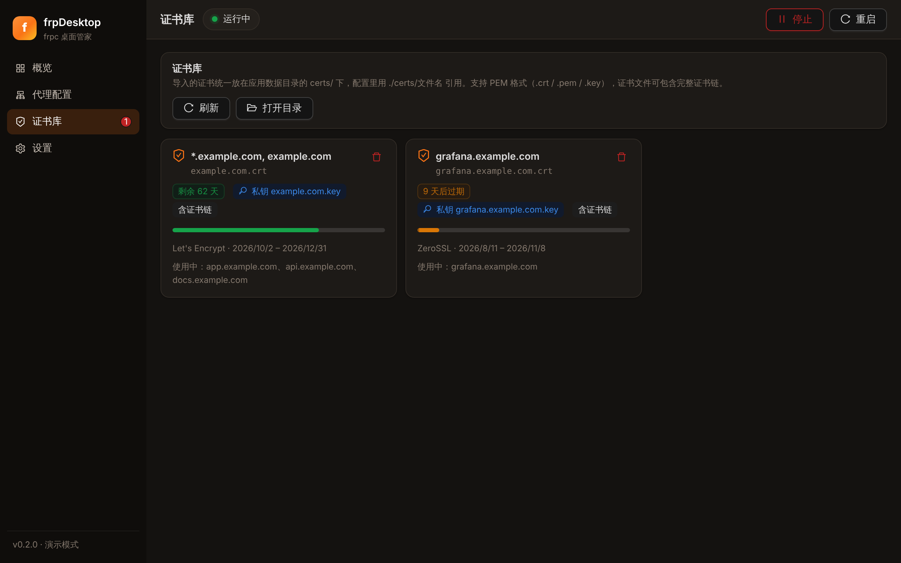
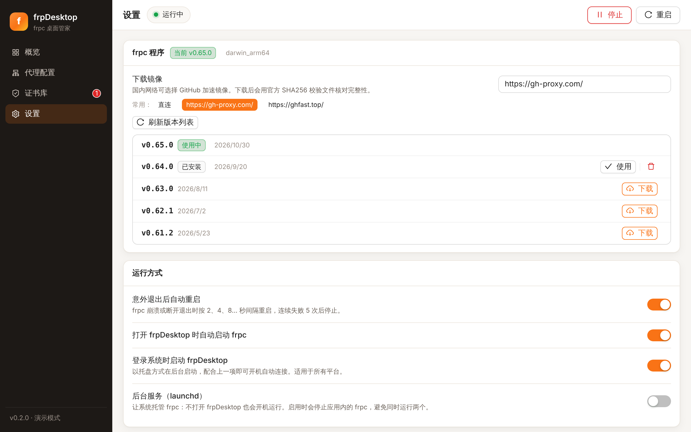
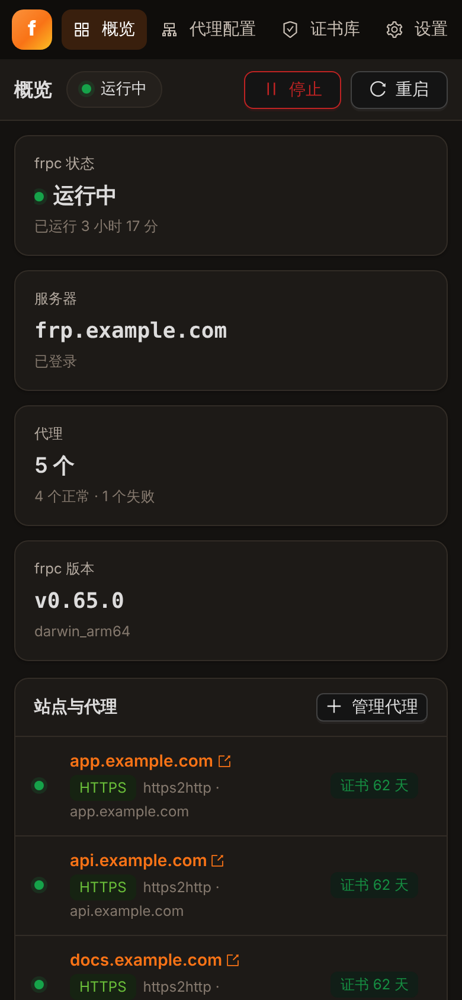
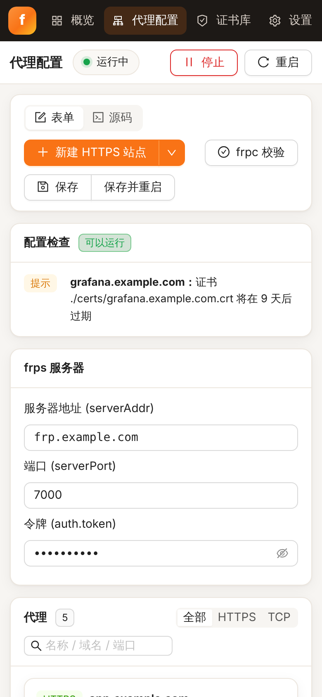

# frpDesktop

> 跨平台的 **frpc 桌面管家**，专为「frps 只开一个端口、用自己的 SSL 证书承载任意多个 HTTPS 域名」而做。


## 截图

| 概览：站点状态、证书剩余天数、实时日志 | 深色模式 |
| --- | --- |
|  |  |
| **代理配置**：表单 / 源码双视图，保存前自动检查 | **HTTPS 站点编辑**：从证书库选择证书，私钥自动配对 |
|  |  |
| **证书库**：到期提醒、证书与私钥配对、使用情况 | **设置**：frpc 版本、镜像、自动重启、后台服务 |
|  |  |
| **窄窗口** | |
|  |  |

> 截图来自演示模式（虚构的 example.com 数据），由 `app/scripts/screenshots.mjs` 生成。

## 主要功能

### HTTPS + 自有证书（核心场景）
- **新建 HTTPS 站点**：填域名和本地地址即可，默认就是 `type = "https"` + `https2http` 插件 + `hostHeaderRewrite` + `requestHeaders.set.x-from-where = "frp"`
- **证书库**：导入 `.crt/.pem/.key`（PEM，可含证书链），自动识别域名、颁发者、有效期，并校验证书和私钥是否配对
- 填完域名后自动挑选能覆盖该域名（含通配符 `*.example.com`）的证书
- 保存前检查：证书文件是否存在、是否过期 / 15 天内过期、是否覆盖域名、证书与私钥是否匹配、localAddr 格式、域名重复等
- 一键 **frpc verify**：用 frpc 自己的校验命令检查配置
- 概览页按日志显示每个代理是否启动成功，域名可点击直接在浏览器打开

### 配置不丢失
- 表单保存时在原 TOML 上就地修改：**注释、键顺序、点号写法以及表单不认识的字段**（`log`、`webServer`、`transport`、`healthCheck`、`metadatas`…）都会原样保留
- 源码视图（CodeMirror，离线可用）随时切换；保存采用原子写入，并保留 `default.toml.bak`
- 导入已有 `frpc.toml`：引用的证书会复制进证书库并改写为 `./certs/…`

### frpc 管理
- 从 GitHub Releases 下载任意版本（macOS / Windows / Linux 各架构），可用国内镜像加速，下载后用官方 `frp_sha256_checksums.txt` 校验
- 也可指定已有的 frpc 程序
- 意外退出自动重启（2/4/8/16/32 秒退避，连续失败 5 次后停止）
- 退出 frpDesktop 时一定会停止它启动的 frpc，不会留下孤儿进程

### 开机运行
- **登录时启动 frpDesktop**（托盘后台）+ **启动后自动运行 frpc**：所有平台可用
- **后台服务**：macOS 使用 launchd，Linux 使用 `systemd --user`，不打开应用也会运行；启用后应用内不会再启动第二个 frpc

## 快速上手

### 1. 服务端 frps 示例

```toml
bindPort = 7000
vhostHTTPSPort = 443
auth.token = "your-strong-token"
```

域名（或通配符域名）解析到 frps 服务器。

### 2. frpDesktop

1. **设置** → frpc 程序：选一个版本点「下载」（国内可先选镜像）
2. **证书库** → 导入证书和私钥
3. **代理配置** → 填写 frps 地址、端口、token → 「新建 HTTPS 站点」→ 填域名和本地地址（如 `127.0.0.1:8080`）→ 证书会自动选好 → 保存
4. 点右上角「启动」，在概览页点域名即可访问 `https://你的域名`

已有 `frpc.toml`？在「代理配置」点「导入 frpc.toml」即可。

### 从 0.1.x 升级

- 数据目录、配置文件和证书目录不变，原有的 `bin/current` frpc 仍然可用
- 旧版的 launchd 开机自启仍会被识别，可在「设置 → 后台服务」中管理
- 0.1.x 用表单保存过的配置可能已经丢失了注释和部分字段，建议检查一次

## 数据位置

| 内容 | 路径（应用数据目录下） |
| --- | --- |
| frpc 配置 | `profiles/default.toml` |
| 证书库 | `certs/`（配置里写 `./certs/文件名`） |
| frpc 程序 | `bin/frpc-v<版本>` |
| 日志 | `logs/frpc.log`（超过 5 MB 自动轮转） |
| 应用设置 | `settings.json` |

frpc 的工作目录就是应用数据目录，所以配置中的相对路径都以它为基准。

## 开发

需要 Node.js ≥ 20、pnpm ≥ 9、Rust stable，以及 [Tauri 2 平台依赖](https://v2.tauri.app/start/prerequisites/)。

```bash
cd app
pnpm install
pnpm tauri dev          # 开发运行
pnpm dev                # 只跑前端，浏览器中自动进入演示模式

# 检查
pnpm build
cd src-tauri && cargo fmt --check && cargo clippy --all-targets -- -D warnings && cargo test

# 更新截图
pnpm build && pnpm preview --port 4173 &
node scripts/screenshots.mjs
```

推送 `v*` tag 会触发 [`release.yml`](./.github/workflows/release.yml) 构建 macOS universal / Windows x64 / Linux x64 安装包到 Draft Release；每个 PR 由 [`ci.yml`](./.github/workflows/ci.yml) 在三个平台上检查。

## 技术栈

- 前端：React 18 + Vite 5 + TypeScript + Ant Design 5 + Zustand + CodeMirror 6
- 后端：Tauri 2 + Rust（`toml_edit` 无损编辑、`x509-parser` + `rustls` 证书检查、`tokio` 进程守护）

## 反馈

Bug 反馈请附带操作系统、frpDesktop 与 frpc 版本、复现步骤和配置（**务必删除 token、证书和私钥**）。

## License

[GPL-3.0](./LICENSE) © [luckySpro](https://github.com/luckySpro)
